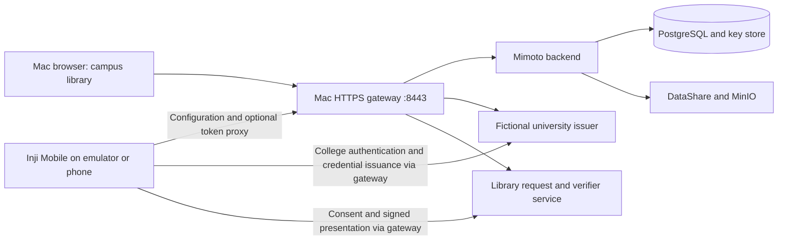

# Mac handoff: local Mimoto backend, Inji Mobile, and campus library

This is the primary guide for a friend or an LLM working on the **native Inji
Wallet app**. Use this guide instead of the older web-wallet startup guide.
Run commands from this repository's root unless another directory is specified.

## 1. What transfers through Git, and what does not

A clone reproduces the **source, configuration templates, fictional student
records, and startup procedure**. It does not reproduce the current Linux laptop's
running Docker state. A fresh Mac gets fresh databases and signing keys, and the
mobile wallet starts empty. That is the intended development handoff.

| Included in this repository | Generated locally; excluded from Git |
| --- | --- |
| Patched Mimoto source and focused tests | Built images, Maven caches, and JARs |
| Mobile Compose file and bootstrap scripts | PostgreSQL, Keycloak, and MinIO data volumes |
| Demonstration university issuer and library verifier | Issuer, verifier, TLS, and Mimoto private keys |
| Fictional student records and public demo passwords | Emulator app data, wallet keys, downloaded cards |
| Web demo instructions, kept as a separate optional example | `docker-compose/certs/`, `mobile-runtime/`, and `local-output/` |

Existing Web cards are not automatically synchronized into Mobile. The native
app keeps its own credentials and wallet keys. Obtain a new credential from
the issuer using the mobile wallet.

To migrate an existing deployment exactly, privately transfer a consistent
backup of its database **and matching PKCS12 store**, Keycloak data, object-store
data, issuer/verifier signing-key volumes, and TLS/configuration files. Mobile
app data needs its own supported backup/restore procedure. Git is not that backup.
For this handoff, use the fresh setup below; do not publish runtime backups/keys.

## 2. Architecture and scope



The native app downloads configuration from Mimoto, performs OpenID4VCI issuance
with the college, stores credentials on the device, and presents them using
OpenID4VP. It does not need the Inji Web frontend or a Web wallet session.

This bundle runs **nine containers**: PostgreSQL, MinIO, DataShare, configuration
Nginx, Keycloak, Mimoto, university issuer, library verifier, and HTTPS gateway.
Keycloak remains a supporting dependency of the backend's existing local OAuth
configuration; native college issuance does not use the Web Keycloak login.
Only the gateway port is published by the mobile Compose file.

The college issuer and library are local demonstration services, not complete
deployments of Inji Certify and Inji Verify. No real university or physical access
system is connected. The existing `local-stack.sh` remains the separate Web demo.

## 3. Mac prerequisites

- Docker Desktop for the Mac's chip architecture, running with Docker Compose v2.
- Git, Python 3, and OpenSSL available on the host. No host Java/Maven/Node is
  required to build/run this backend bundle: those tools run in containers.
- Approximately 6–8 GB available to Docker, enough disk for Java images/caches,
  and additional host memory for the Android emulator/Xcode. This is a practical
  starting allocation, not a measured minimum. Keep Internet access for initial
  builds and standard JSON-LD context resolution.
- A working native app project and emulator are managed separately by the app
  developer. This repository does not build/install the React Native app.

On **Apple Silicon**, DataShare and the legacy MinIO image used here are amd64.
The Compose file explicitly sets `platform: linux/amd64` for those two services;
other images build/run for the host architecture. Enable amd64 emulation in
Docker Desktop. If available, Apple Virtualization Framework with Rosetta can
accelerate it. Do not set `DOCKER_DEFAULT_PLATFORM=linux/amd64` globally: that
would unnecessarily emulate the Java build and other services too.
[Docker Mac settings](https://docs.docker.com/desktop/settings-and-maintenance/settings/)

Check:

```bash
docker version
docker compose version
git --version
python3 --version
openssl version
```

## 4. Clone and choose a reachable address

Clone the backend repository. This is separate from your existing, customized
Inji Mobile checkout:

```bash
git clone https://github.com/sk00l/inji-backend.git
cd inji-backend
git rev-parse HEAD
```

Use one stable **Mac LAN IPv4 address**, such as `192.168.1.50`, as the shared
identity of this development deployment. Find your current address:

```bash
ipconfig getifaddr en0
```

If that returns nothing, find the active Wi-Fi/Ethernet interface in macOS
Network settings and use its IPv4 address. Use a DHCP reservation if possible.
The Mac, Docker containers, emulator, and any physical phone must all reach this
same address. A VPN, guest Wi-Fi client isolation, or firewall can block it.

Do not initialize with `localhost`, `127.0.0.1`, `0.0.0.0`, a Docker container IP,
or Android's `10.0.2.2`. This profile intentionally uses one LAN identity so that
the issuer URL, DID, QR request, and TLS certificate agree for every client.

Android's `localhost` is the emulator itself; `10.0.2.2` is a special alias for
the Mac host loopback. That alias is useful for other setups but must not replace
just one URL in this profile. [Android emulator networking](https://developer.android.com/studio/run/emulator-networking-address)

## 5. Generate local settings and keys, build, and start

Replace the example IP with the Mac address from step 4:

```bash
bash docker-compose/mobile-stack.sh init 192.168.1.50
bash docker-compose/mobile-stack.sh build
bash docker-compose/mobile-stack.sh up
bash docker-compose/mobile-stack.sh check
bash docker-compose/mobile-stack.sh protocol-check
bash docker-compose/mobile-stack.sh tests
```

`init` creates ignored files under `docker-compose/mobile-runtime/`: generated
issuer/verifier configuration, `.env` settings, a development CA and leaf
certificate, JVM truststore, and Mimoto PKCS12 client/key store. Existing files
and keys are preserved. The gateway certificate includes the selected IP as a
subject alternative name. The build compiles Mimoto and runs focused Java tests.
It does not clone or build Inji Web.

If 8443 is already occupied, choose a port at initialization:

```bash
bash docker-compose/mobile-stack.sh init 192.168.1.50 --port 9443
```

Use that same port in every URL below. After `init`, the wrapper supplies the
generated environment file to Compose. For direct Compose use:

```bash
docker compose --env-file docker-compose/mobile-runtime/mobile.env \
  -f docker-compose/compose.mobile.yaml ps
```

Do not launch `docker compose up` from the legacy `docker-compose/` directory and
expect it to select the mobile profile. The mobile project is named
`inji-mobile-dev`, uses its own volumes, and can coexist with the Web demo.

### Expected endpoints

For the example address:

| URL | Purpose |
| --- | --- |
| `https://192.168.1.50:8443/v1/mimoto/actuator/health` | Backend health; expect `status: UP` |
| `https://192.168.1.50:8443/v1/mimoto/allProperties` | Native app configuration |
| `https://192.168.1.50:8443/v1/mimoto/issuers` | Mobile issuer list; includes `UniversityMobile` |
| `https://192.168.1.50:8443/v1/mimoto/issuers/UniversityMobile` | Client/redirect/issuer details |
| `https://192.168.1.50:8443/v1/mimoto/verifiers` | Trusted library verifier |
| `https://192.168.1.50:8443/issuer/.well-known/openid-credential-issuer` | Issuer metadata |
| `https://192.168.1.50:8443/issuer/.well-known/oauth-authorization-server` | College authorization metadata |
| `https://192.168.1.50:8443/issuer/did.json` | University signing-key DID document |
| `https://192.168.1.50:8443/` | Campus library portal |

Example independent health request, using the generated CA:

```bash
curl --cacert docker-compose/mobile-runtime/certs/verifier-ca.pem \
  https://192.168.1.50:8443/v1/mimoto/actuator/health
```

No Google Console, paid issuer account, or hosted Inji sandbox is required for
the university scenario. Some standard context resolution may still access the
Internet; disconnected operation is not claimed.

## 6. Configure the already-running Inji Mobile project

Reference source inspected for this handoff: official `inji/inji-wallet` commit
**`2b37c058a9ae10216e099dce78fbda57069d41ef`**. Inspect your friend's actual
revision before changing it; an older SDK may use a different OpenID4VCI draft.
The local issuer implements the final protocol, including nonce endpoint,
`credential_configuration_id`, `proofs.jwt`, and `credentials` response array.

**Use the friend's existing customized Inji Mobile repository in its separate
folder. Do not clone a replacement mobile repository, check out the reference
commit over their work, reset their branch, or overwrite frontend changes.** The
pinned upstream source is a reference for comparison only. Inspect the existing
app's branch, working-tree changes, scripts, SDK versions, and `AGENTS.md` first;
make only the local backend integration changes needed in that checkout.

For example, the directories can be siblings (the actual mobile folder name can
differ):

```text
projects/
  inji-backend/          # This repository; run mobile-stack.sh here
  existing-mobile-app/  # Friend's existing app and frontend changes
```

If the app folder cannot be identified, ask for its path. Backend setup can
continue independently while that path is being located. There is no requirement
to rename or move the existing app folder.

In the **mobile app repository**, merge these values into `.env.local` without
discarding existing app configuration:

```dotenv
MIMOTO_HOST=https://192.168.1.50:8443
CREDENTIAL_REGISTRY_EDIT=true
```

Use the origin only: do **not** append `/v1/mimoto` and do not add a trailing
slash. The inspected app builds its API paths itself. A generated example is
available at `docker-compose/mobile-runtime/wallet.env.example` in this backend
repository. Do not copy backend client private keys or secrets into the app.

Restart Metro with its cache reset using the app's existing scripts, then rebuild
the development app. If a previously selected credential registry overrides the
environment setting, select the new registry in app settings. The inspected app
also caches issuer/verifier configuration for about an hour: invalidate the
relevant development cache or start with a fresh emulator app profile. Do not
wipe an existing personal wallet to change a backend URL.

Source references:

- [Environment setup](https://github.com/inji/inji-wallet/blob/2b37c058a9ae10216e099dce78fbda57069d41ef/README.md)
- [API paths](https://github.com/inji/inji-wallet/blob/2b37c058a9ae10216e099dce78fbda57069d41ef/shared/api.ts)
- [Trusted issuer issuance and token proxy](https://github.com/inji/inji-wallet/blob/2b37c058a9ae10216e099dce78fbda57069d41ef/machines/Issuers/IssuersService.ts)
- [Native callback example](https://github.com/inji/inji-wallet/blob/2b37c058a9ae10216e099dce78fbda57069d41ef/shared/vciClient/VciClient.ts)

### Local HTTPS trust: Android development build

The app and emulator must trust the **public development CA**, not just your
Mac's browser. Do not disable TLS checks.

1. Copy `docker-compose/mobile-runtime/certs/verifier-ca.pem` into the mobile
   project's **debug-only** Android resources as
   `android/app/src/debug/res/raw/inji_local_ca.pem` (create the directory).
   This is the public certificate; never copy `verifier-ca.key`.
2. In the existing debug network security configuration, merge:

   ```xml
   <debug-overrides>
       <trust-anchors>
           <certificates src="@raw/inji_local_ca"/>
       </trust-anchors>
   </debug-overrides>
   ```

   Put this inside `<network-security-config>`, preserving the existing contents.
   The inspected source uses
   `android/app/src/debug/res/xml/network_security_config.xml`, referenced by its
   debug manifest. Rebuild the debug app. Do not change the release manifest.
3. If the college authentication opens an emulator browser that needs separate
   trust, install the public CA in the emulator's certificate settings:

   ```bash
   adb push docker-compose/mobile-runtime/certs/verifier-ca.pem /sdcard/Download/inji-local-ca.crt
   adb shell am start -a android.settings.SECURITY_SETTINGS
   ```

   Select the downloaded certificate as a CA certificate in the emulator UI.
   The exact Settings labels vary by Android version. Copying it with `adb push`
   alone does not install or trust it. The debug app trust configuration and
   browser certificate store are separate checks.

[Android's official debug CA instructions](https://developer.android.com/privacy-and-security/security-config)

For the Mac library browser, import only the public CA into your development
user's Keychain and trust it for this local lab, or use your organization's
approved development trust procedure. The bootstrap does not modify Mac trust.

### iOS Simulator

With the intended simulator booted, install the public CA:

```bash
xcrun simctl keychain booted add-root-cert docker-compose/mobile-runtime/certs/verifier-ca.pem
```

Check reachability from simulator Safari and the native app separately. If local
network permission is requested, allow it for the development app. Do not add
blanket TLS bypasses. [Apple Simulator certificate guidance](https://developer.apple.com/videos/play/wwdc2020/10647/)

**iOS verification limitation in the inspected upstream revision:**
`shared/vcjs/verifyCredential.ts` returns success for `Ed25519Signature2020` in its
iOS issuance verification path, with a TODO for the verifier implementation.
The library service here independently verifies the credential and presentation,
but an iOS download success is not evidence that iOS checked the issuer signature.
Inspect/fix that behavior in the app revision you use before making that claim.
[Pinned source](https://github.com/inji/inji-wallet/blob/2b37c058a9ae10216e099dce78fbda57069d41ef/shared/vcjs/verifyCredential.ts)

## 7. Start empty and obtain a college-issued card in the native app

This is **not** the Web username/password wallet-login walkthrough. In the
inspected native reference app, users first set up/unlock their local wallet with
the app's passcode/biometric flow. College credentials are entered during
issuance. Cloud backup login is a separate feature and is not needed here.

1. Launch a fresh development wallet in the emulator and complete local setup.
2. Confirm there are no stored credentials.
3. Choose the app's add/download credential action.
4. Select **Himalaya University (Demo)** and **University Student ID**.
5. The college authentication page opens. Use **`nisha` / `nisha-local-password`**.
6. Select **Issue my student ID**. The native callback is
   **`io.mosip.residentapp.inji://oauthredirect`**.
7. The app completes the code/PKCE exchange, proves possession of its wallet key,
   receives the signed card, verifies it where the app implementation supports
   that verification, and stores it on the device.
8. Inspect the credential: **Nisha Gurung / HU-2026-0002 / active**.

Mobile profile configuration is **client ID `university-mobile`**, issuer ID
**`UniversityMobile`**, and the callback above. The issuer registers it as a public
native OAuth client with mandatory PKCE; no client secret is shipped in the app.
The existing Mimoto token proxy is also configured for trusted-issuer app paths
that route the exchange through Mimoto. The synthetic protocol check tests both
exchange paths. Start with the issuer list flow; credential-offer QR issuance is
not implemented in this demo.

The name comes from the authenticated **college record**, not an editable wallet
display name. Other fictional college accounts remain `student` /
`student-local-password` for Aarav Sharma and `alumni` / `student-local-password`
for a graduated student. These are demonstration passwords, not real accounts.
No card is seeded into the native app by backend startup or protocol checks.

If a custom credential type renders incompletely in your app fork, inspect its
credential display/claim rendering configuration; confirm the actual JSON claims
before adjusting the UI. Do not replace verification with a hardcoded success.

## 8. Library on the Mac: request QR → mobile consent → verification

The library is a separate small application already included in Compose. A
separate native Mac application is not required; its UI runs in the Mac browser.

1. Open **`https://192.168.1.50:8443/`** on the Mac after configuring CA trust.
2. Select **Present student ID - show request QR**.
3. The page displays a fresh five-minute **OpenID4VP request QR** and its URL.
4. On a physical phone, open Inji Mobile's scanner and scan that request QR.
5. Review the library request, select the student ID, and consent. Follow any
   biometric/face prompts supported by the app/device. The card contains no face
   photo, and this demo does not assert a face-match result.
6. The app submits a signed presentation to the library through the HTTPS gateway.
7. The Mac library page polls the result and displays approval only after checks
   pass. Repeat with declined sharing to show that no access is granted.

**An emulator camera often cannot scan the Mac's own screen.** To exercise the
same request in an emulator, copy the full **Emulator request URL** shown under
the QR. Open it using the platform command below. Replace the complete placeholder
with the newly generated `openid4vp://authorize?...` URL and keep it quoted:

```bash
# Android: pass the URL as one quoted remote-shell argument, including its & characters.
adb shell "am start -W -a android.intent.action.VIEW -d 'PASTE_FULL_OPENID4VP_URL_HERE'"

# iOS Simulator:
xcrun simctl openurl booted 'PASTE_FULL_OPENID4VP_URL_HERE'
```

Deep-link testing exercises request handling and presentation; it does not test
camera scanning. Real-camera QR acceptance requires a physical phone or a
configured emulator camera feed. The QR SVG is generated locally; no public QR
generation service receives the request.

The library validates its fresh state/challenge, verifier audience, wallet
signature, trusted university credential signature, holder key binding, validity
dates, and active enrollment. A validly signed graduated-student card is denied.
Completed requests cannot be reused.

This is **not scanning the QR printed on the student ID**. The ID QR carries a
credential; the library QR requests a fresh signed presentation. A copied ID
image alone does not prove control of the wallet's private key.

Scope limits: full student-card disclosure, no live student-information-system
query, no revocation/status service, only the configured Ed25519 JSON-LD format,
and no actual door controller. The verifier is a development implementation,
not a general-purpose OpenID4VP conformance product. See
[UNIVERSITY_DEMO.md](UNIVERSITY_DEMO.md) for the single-descriptor compatibility
adapter for the existing Web Mimoto revision.

## 9. Acceptance checklist and verification boundaries

| Check | How to verify |
| --- | --- |
| Container readiness and public HTTPS identities | `bash docker-compose/mobile-stack.sh check` |
| PKCE, direct/proxied token exchange, signed issuance, real library signature/policy checks, tampering and replay rejection | `bash docker-compose/mobile-stack.sh protocol-check` |
| University signing, verification, wrong-holder, validity and registrar-record tests | `bash docker-compose/mobile-stack.sh tests` |
| Mobile Mimoto connection | App receives issuer list and trusted verifier from this Mac |
| Native issuance | Empty device wallet obtains Nisha's card through college authentication |
| Native presentation | Emulator deep link or phone QR → consent → library approval |
| Decline | A new request is declined; library grants no access |
| Graduated student | A valid graduate credential results in denial |
| Restart persistence | Container restart retains issuer keys; app restart retains its own card |

Backend/protocol checks use a synthetic wallet key and do not populate the app.
They cannot establish Android/iOS interoperability or camera behavior. The real
app acceptance rows must be completed on the friend's actual app revision.
Do not report those rows as passed merely because the backend is healthy.

## 10. Everyday operation and troubleshooting

```bash
bash docker-compose/mobile-stack.sh ps
bash docker-compose/mobile-stack.sh logs mimoto-service
bash docker-compose/mobile-stack.sh logs university-issuer
bash docker-compose/mobile-stack.sh logs demo-verifier
bash docker-compose/mobile-stack.sh logs mobile-gateway
bash docker-compose/mobile-stack.sh down
bash docker-compose/mobile-stack.sh up
```

`down` preserves volumes; `down -v` would delete them and is not the normal stop
procedure. The wrapper intentionally does not provide a reset/delete command.
Rebuild after source changes, then run `up` again. Use the mobile Compose file for
all services; do not mix a mobile database with the Web profile's keys.

| Symptom | Check/fix |
| --- | --- |
| No matching manifest / exec format error on an M-series Mac | Enable amd64 emulation for the two legacy images; preserve their explicit `platform` settings |
| Maven process killed or Docker build exits 137 | Increase Docker memory, close unnecessary emulator workloads during build, then retry; caches are retained |
| File sharing/mount denied on Mac | Add the checkout directory to Docker Desktop file sharing; verify paths are files, not accidentally created directories |
| Backend not yet healthy | Wait for first database/key initialization; inspect Mimoto/PostgreSQL/Keycloak logs |
| Host health works but app cannot connect | Confirm the same Mac LAN IP, emulator network access, macOS firewall, VPN, and app debug CA trust |
| Certificate name mismatch | Use the exact IP/port chosen at init; do not replace only `MIMOTO_HOST` with localhost or 10.0.2.2 |
| Issuer still points at a hosted sandbox | Check app registry override/cache and restart Metro after `.env.local` changes |
| App receives duplicated `/v1/mimoto` or malformed URL | `MIMOTO_HOST` must be the HTTPS origin only, without a trailing slash |
| College callback returns to Web or is rejected | Mobile issuer ID/client/callback must match this guide; do not use the legacy Web issuer configuration |
| Token exchange fails | Inspect issuer + Mimoto logs; verify client ID, exact callback, and PKCE; never place server private keys in the app |
| Credential request shape rejected | Compare native VCI SDK version to final OpenID4VCI metadata; inspect request without logging bearer tokens/private keys |
| QR expires | Generate a new request; it lasts five minutes and completed states are consumed |
| “Belongs to another wallet” | Present a card issued to this mobile wallet's key; a Web-issued holder-bound VC cannot simply be copied into Mobile |
| App stores a card but library rejects it | Inspect the actual result, issuer signature, context resolution, dates, proof format, holder key and request challenge; do not weaken checks |
| Health reports sandbox issuer failure | Mobile configuration includes only `UniversityMobile`; legacy Web `check` also probes an external Mock issuer |

### Changing networks or origin

The public address forms part of the issuer's DID and every issued card. The
bootstrap refuses to silently change it. Keep a stable LAN address or choose a
stable, properly reachable DNS/TLS arrangement before issuing cards. If you need
a new origin for a disposable lab, deliberately provision a separate Compose
project, runtime directory, and fresh signing-key/data volumes, update the app
configuration and CA trust, and issue new cards. Preserve the old project if its
cards/data matter. Do not rename the URL while retaining an incompatible issuer
key controller or overwrite a store used by an existing database.

## 11. Put the handoff on GitHub

All custom code, tests, Compose files, scripts, pinned Node lockfile, and these
Markdown guides must be included. A sibling `inji-web` checkout is not needed
for the mobile profile. No sibling mobile source checkout is required for backend
startup; the friend keeps their app project separately.

Before staging, review the checkout and its ignored runtime files:

```bash
git status --short
git check-ignore docker-compose/mobile-runtime/settings.json
git check-ignore docker-compose/certs/oidckeystore.p12
```

Stage the intended source/docs after review, then inspect the staged diff and
file list. Ensure it includes the new untracked files as well as Java patches.
Do not force-add ignored certificate directories, `.env.local`, database dumps,
runtime output, or volumes. Upstream contains sample test keystores; those are
distinct from the newly generated operational stores ignored by this handoff.

For this handoff, the intended paths are below. Review any unrelated local
changes in these directories before staging:

```bash
git add -- .gitignore .dockerignore README.md \
  MAC_MOBILE_HANDOFF.md FRIEND_LLM_PROMPT.md UNIVERSITY_DEMO.md \
  LOCAL_DOCKER_SETUP.md INJI_WEB_FEATURE_TOUR.md \
  docker-compose src/main/java src/test/java
```

```bash
git diff --cached --stat
git diff --cached --name-only
```

This handoff's backend remote is **https://github.com/sk00l/inji-backend.git**.
`origin` should point there; the original `inji/mimoto` remote can be retained as
`upstream`. Inspect `git remote -v` before publishing. Commit and push backend
changes to this repository, not the friend's mobile repository or upstream Inji.
The startup scripts do not perform Git pushes. Share the exact commit ID, this guide, and
[FRIEND_LLM_PROMPT.md](FRIEND_LLM_PROMPT.md).

## 12. Sources and verification record

- [Inji Mobile issuance workflow](https://docs.inji.io/inji-wallet/inji-mobile/functional-overview/feature-workflows)
- [Mobile same-device and cross-device presentation](https://docs.inji.io/inji-wallet/inji-mobile/functional-overview/end-user-guide)
- [Pinned official mobile source](https://github.com/inji/inji-wallet/tree/2b37c058a9ae10216e099dce78fbda57069d41ef)

The existing Web university scenario passed 206 focused Java tests, university
unit tests, signed issuance/storage/PDF checks, presentation approval, decline,
and replay checks on Linux. The mobile profile was also built and started from
fresh, isolated volumes on Linux on October 24, 2026. Its source build passed 206
focused Java tests; all 10 university unit tests passed. CA-verified HTTPS checks
passed for the backend, issuer metadata/DID, library keys, and generated QR. The
synthetic protocol check passed native callback/PKCE enforcement, direct and
Mimoto-proxied token exchange, holder-bound issuance, nonce replay rejection,
library approval, tampered credential rejection, and completed-request replay
rejection.

Mac Docker Desktop, Apple Silicon emulation, and native emulator acceptance must
still be checked on the destination Mac. This guide does not claim an unperformed
mobile app end-to-end test.
